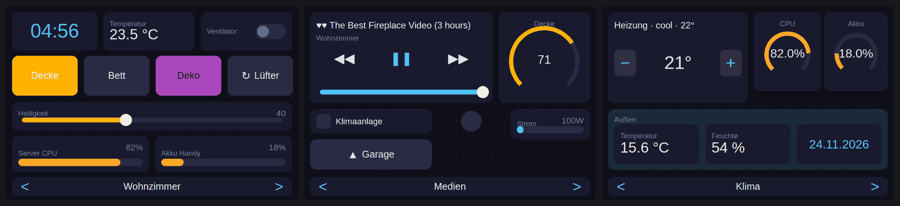
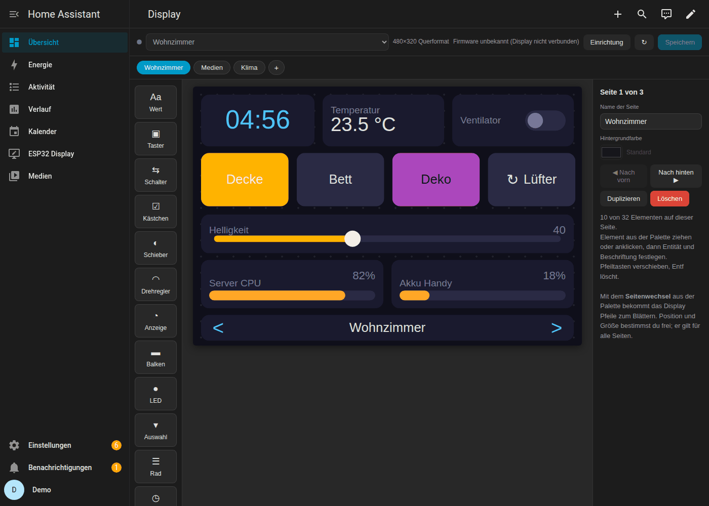
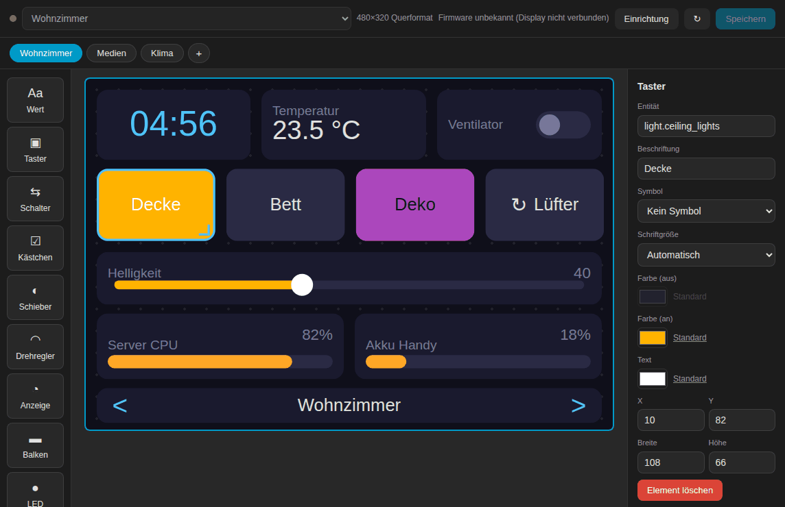
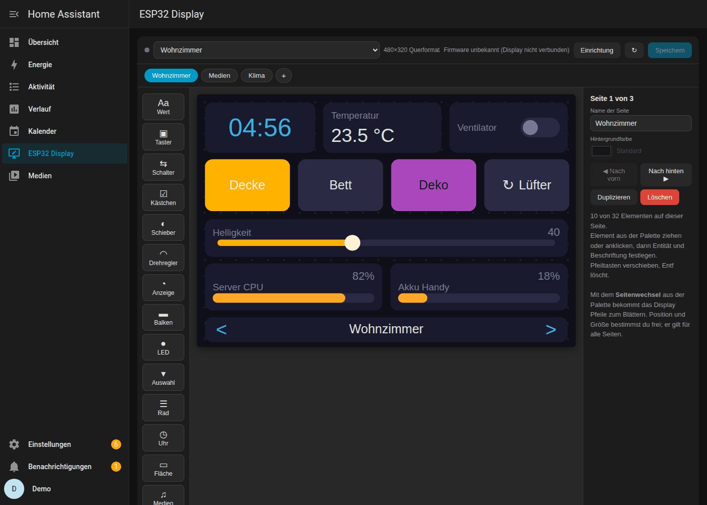
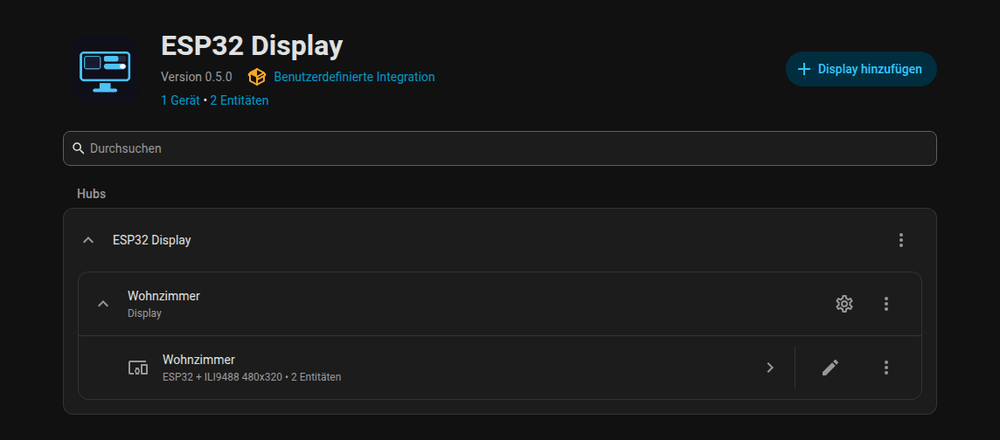

# ESP32 Display – Home-Assistant-Panel

Selbstgebautes Touch-Panel (ESP32 + ILI9488 480×320) für Home Assistant. Das Layout gestaltest du **grafisch in Home Assistant** – ohne die Firmware neu zu flashen. Änderungen erscheinen sofort auf dem Display.

- **Eine Integration, beliebig viele Displays** – Geräte sind Unterkonten; **kein Home-Assistant-Token im Display**
- **Visueller Editor** als Lovelace-Karte **und** als Eintrag in der Seitenleiste: Elemente ziehen, Entität wählen, speichern
- **15 Elemente**: Wert, Taster, Schalter, Schieber, Drehregler, Anzeige, Balken, LED, Uhr, Auswahl, **Medien**, **Thermostat** u. a.
- **Farben** frei wählbar: Seitenhintergrund, je Element Farbe aus/an (je nach Zustand der Entität) und Text; Warn-/Kritisch-Schwellen; 36 Symbole; Schriftgröße
- **Mehrere Seiten** pro Display mit frei platzierbarem **Seitenwechsel** (Pfeile links/rechts, Seitenname oder Nummer in der Mitte)
- **Hoch- oder Querformat**, pro Display einstellbar
- **Firmware-Updates über WLAN (OTA)**, direkt aus der Karte oder aus Home Assistants Update-Seite
- **Fertige Firmware** zum Flashen, Ersteinrichtung per WLAN-Hotspot am Handy
- **Live-Werte** und **Touch-Bedienung** (Taster, Schalter, Schieber, Medien, Thermostat) direkt am Display
- Alles aus einem Repository, Installation über **HACS**

## Screenshots

So sehen drei Seiten eines Displays aus (Demo-Layout, Darstellung wie im Editor):



Der Editor als Lovelace-Karte – Elemente aus der Palette links ziehen, rechts die Eigenschaften einstellen:



Eigenschaften eines Elements: Entität, Beschriftung, Symbol, Schriftgröße, Farben (aus/an), Position und Größe.



Der Editor als eigener Eintrag in der Seitenleiste:



Jedes Display ist ein Gerät der Integration:



## Hardware

| Bauteil | Wert |
|---|---|
| MCU | ESP32-WROOM-32D |
| Display | ILI9488 **oder** ILI9481, 480×320, SPI |
| Touch | XPT2046 |

Pinbelegung (wie im Schaltplan):

| Signal | GPIO | Signal | GPIO |
|---|---|---|---|
| MOSI | 23 | TFT CS | 15 |
| SCLK | 18 | TFT DC | 2 |
| MISO | 19 | TFT RST | 4 |
| Touch CS | 14 | Backlight (TFT_LED) | **32** |

T_IRQ (IO27) und der Piezo-Treiber (IO26) werden von der Firmware nicht genutzt.

## Installation

### 1. Integration über HACS

1. HACS → ⋮ → **Benutzerdefinierte Repositories** → `https://github.com/hypersonic30/ha-display`, Kategorie **Integration**
2. **ESP32 Display** installieren, Home Assistant neu starten
3. **Einstellungen → Geräte & Dienste → Integration hinzufügen → ESP32 Display** – gefragt wird nur die **Home-Assistant-URL**, unter der die Displays Home Assistant erreichen (vorausgefüllt), z. B. `http://192.168.1.10:8123`
4. In der Integration **Display hinzufügen** – Name (z. B. `Küche`), Helligkeit und **Ausrichtung** (Quer-/Hochformat, auch gedreht). Jedes Display ist ein Unterkonto und bekommt automatisch einen **eigenen Gerätecode**.

Die Karte wird automatisch geladen, ein manueller Ressourcen-Eintrag ist nicht nötig. Jedes Display bekommt außerdem einen Sensor **„Verbunden“** (z. B. für eine Automatisierung „Display offline“).

**Es gibt kein Home-Assistant-Token.** Die Displays reden nur mit der Integration, und die spricht innerhalb von Home Assistant mit allem anderen. Ein Display kennt nur seinen eigenen Gerätecode. Ein gestohlenes Display kann damit höchstens die Elemente bedienen, die in *seinem* Layout liegen (Licht, Schalter, Skripte, Szenen, Medien, Thermostate …) – keine Schlösser, Alarmanlagen oder beliebige Dienste. Mit „Display bearbeiten → Neuen Gerätecode erzeugen“ sperrst du ein Display sofort aus.

### 2. Firmware flashen

Fertige Dateien liegen in [`firmware/bin/`](firmware/bin) und bei den [Releases](https://github.com/hypersonic30/ha-display/releases). **Nimm die Datei passend zu deinem Display-Controller:**

| Controller | Firmware |
|---|---|
| ILI9488 | `firmware-ili9488.bin` |
| ILI9481 | `firmware-ili9481.bin` |

```bash
pip install esptool
esptool.py --chip esp32 --port /dev/ttyUSB0 --baud 921600 write_flash \
  0x1000  bootloader.bin \
  0x8000  partitions.bin \
  0x10000 firmware-ili9488.bin        # oder firmware-ili9481.bin
```

(Windows: Port z. B. `COM3`.) Bleibt das Display weiß oder zeigt Müll, ist es der falsche Controller. Sind beim ILI9481 Rot und Blau vertauscht oder die Farben negativ, siehe die Hinweise in `firmware/platformio.ini`. Beim ersten Start kalibrierst du den Touch: die Markierungen an den Ecken antippen. Die Werte werden gespeichert; **beim Einschalten 3 s den Touch halten** kalibriert neu.

### Firmware später aktualisieren (OTA)

Das **erste** Flashen geschieht per Kabel (siehe oben). Danach brauchst du es nicht mehr: Die Firmware-Images liegen in der Integration, die Karte zeigt die Version deines Displays an, und ist eine neuere da, erscheint **„Firmware 0.3.0 → 0.3.1 verfügbar“** mit einem Knopf **Aktualisieren**. Dasselbe findest du unter Einstellungen → System → Updates (Entität „Firmware“ je Display).

- Das Display muss eingeschaltet und verbunden sein. Es lädt das Image von deiner Home-Assistant-Instanz (mit seinem Gerätecode), prüft die Prüfsumme, zeigt einen Fortschrittsbalken und startet neu. Währenddessen nicht ausschalten.
- **Rückfall:** Startet die neue Firmware nicht richtig (Absturz-Schleife), schaltet das Display nach wenigen Neustarts automatisch auf die vorherige Firmware zurück. Das Update-Angebot bleibt dann bestehen, und ein Fehler wird angezeigt.
- Die Integration bringt die Images mit; welche Version zu welchem Display passt (ILI9488 oder ILI9481), erkennt sie selbst.
- Ein Display mit einer Firmware **vor 0.3.0** kann nicht per OTA aktualisiert werden und muss einmal per Kabel geflasht werden.

### 3. Display einrichten

Ohne gespeicherte Zugangsdaten öffnet das Display einen WLAN-Hotspot. **SSID und Passwort stehen auf dem Display** (WPA2, das Passwort ändert sich bei jedem Start).

1. Mit dem Hotspot `ESP32-Display-XXXX` verbinden
2. In der Karte unter **Einrichtung** den **Einrichtungslink** kopieren und im Browser öffnen (Alternative: `http://192.168.4.1` öffnen und Home-Assistant-URL sowie Gerätecode einfügen)
3. Dein **WLAN** auswählen und das Passwort eingeben – URL und Gerätecode sind über den Link schon eingetragen

Danach verschwindet der Hotspot, das Display verbindet sich und lädt Name, Helligkeit und Layout. Bei Problemen zeigt es den Grund an (WLAN nicht erreichbar, Home Assistant/Integration nicht gefunden, Gerätecode abgelehnt) und versucht es weiter – gespeicherte Daten werden nie automatisch gelöscht. **Touch 3 s halten** auf einem Statusbildschirm öffnet die Einrichtung erneut.

> Tipp: Kopiere den Einrichtungslink, **bevor** du dich mit dem Hotspot verbindest – danach hat dein Handy meist kein Home Assistant mehr.

### 4. Editor öffnen

Der Editor erscheint nach der Einrichtung als **ESP32 Display in der Seitenleiste** (nur Administratoren; abschaltbar unter *Verbindung bearbeiten*). Alternativ legst du ihn als Karte aufs Dashboard:

Dashboard bearbeiten → Karte hinzufügen → **ESP32 Display** (oder YAML):

```yaml
type: custom:display-card
device: Küche      # optional: ohne Angabe wählst du das Display in der Karte aus
```

## Layout-Editor

- Element aus der **Palette** ziehen oder anklicken
- Auf dem Display-Abbild verschieben (Raster 5 px), an der Ecke **Größe ändern**, Pfeiltasten verschieben (Shift = 5 px), `Entf` löscht
- Rechts, je nach Element: **Entität**, **Beschriftung**, **Symbol**, **Aktion** (Taster), Attribut statt Zustand, Einheit, Min/Max, Warn-/Kritisch-Schwellen, Uhrformat, **Schriftgröße**, **Farben**, Position und Größe
- Ist kein Element ausgewählt, stellst du rechts die **Hintergrundfarbe der Seite** ein
- Die Vorschau zeigt die **aktuellen Werte** aus Home Assistant und hat die Form deines Displays (Quer- oder Hochformat)
- **Speichern** prüft das Layout in Home Assistant und schickt es sofort ans Display

### Seiten und Seitenwechsel

- Über der Fläche stehen die **Seiten** als Reiter, mit **+** legst du eine neue an (bis zu 8). Ist kein Element ausgewählt, kannst du rechts die Seite **umbenennen, verschieben, duplizieren oder löschen**.
- Jede Seite hat ihre eigenen Elemente (bis 32). Das Display zeigt immer eine Seite.
- Das Element **Seitenwechsel** aus der Palette bringt Pfeile zum Blättern: links `<`, rechts `>`, in der Mitte der Seitenname oder „2 / 3“. **Position und Größe bestimmst du frei**, es liegt auf allen Seiten an derselben Stelle und erscheint am Display erst, wenn es mindestens 2 Seiten gibt. Blättern geht im Kreis.

| Element | Zweck | Bedienung am Display |
|---|---|---|
| Wert | Zustand oder Attribut mit Einheit, optional mit Symbol | – |
| Taster | Farbe wechselt bei „an“, Symbol möglich, feste Aktion wählbar | tippen: `button`/`input_button` → drücken, `scene`/`script` → starten, Medien/Rollladen/Staubsauger/Thermostat → gewählte Aktion, sonst umschalten |
| Schalter, Kästchen | Ein/Aus | tippen |
| Schieber, Drehregler | Helligkeit, Rollladenposition, Lüfter, Lautstärke, `input_number`/`number` | ziehen |
| Anzeige, Balken | Wert mit Min/Max, Farbe wechselt bei Warn-/Kritisch-Schwelle (auch „darunter“) | – |
| LED | Statuspunkt (an/aus-Farbe) | – |
| Auswahl, Rad | `select`, `input_select`, Quelle eines Mediaplayers | wählen |
| Uhr | Uhrzeit/Datum (Zeit und Zeitzone kommen von Home Assistant) | – |
| Fläche | Rechteck zum Gruppieren und Einfärben | – |
| Medien | Titel, Interpret, Zurück/Wiedergabe/Weiter, Lautstärke | tippen, ziehen |
| Thermostat | Ist- und Solltemperatur, `−`/`+` (Schritt und Grenzen aus dem Gerät) | tippen |
| Seitenwechsel | `<` Name `>` | tippen: nächste/vorherige Seite |

**Farben:** Jede Seite hat eine Hintergrundfarbe, jedes Element Farbe (aus), Farbe (an) und Textfarbe. „Standard“ setzt zurück. Als „an“ gelten die Zustände `on`, `open`, `playing`, `home`, `heat` und ähnliche. **Symbole** (36, z. B. Ein/Aus, Play, Haus) lassen sich bei Taster und Wert setzen. Die **Schriftgröße** (12 bis 24 px, bei der Uhr bis 48 px) ist für den Haupttext von Wert, Taster, Schalter, Kästchen, Auswahl, Medien, Thermostat und Uhr einstellbar; „Automatisch“ ist die Standardgröße. Das Format aller Felder und Nachrichten steht in [docs/protocol.md](docs/protocol.md).

**Bewusst nicht bedienbar:** Schlösser und Alarmanlagen (ein gestohlenes Display soll keine Tür öffnen). Anzeigen sind möglich.

Grenzen: höchstens 8 Seiten mit je 32 Elementen, Beschriftung und Seitenname ≤ 31 und Einheit ≤ 15 Bytes (Umlaute und ° zählen doppelt). Umlaute, `°` und `€` werden dargestellt.

### Ausrichtung

Unter **Display bearbeiten** wählst du, wie das Display eingebaut ist (Querformat, Hochformat 90°, Querformat 180°, Hochformat 270°). Die Karte zeigt die Fläche entsprechend, und bei einem Wechsel wird dein Layout automatisch auf die neue Größe angepasst (Elemente werden verschoben oder verkleinert, nichts geht verloren). **Der Touch muss nach einem Wechsel einmal neu kalibriert werden** – das Display fragt automatisch danach. Für jede Ausrichtung wird die Kalibrierung getrennt gespeichert.

## So funktioniert es

```
Editor (Karte/Seitenleiste) ──HA-WebSocket──▶ ┐
                                 ├─ Integration „display“ ──▶ Home Assistant (Zustände, Dienste)
ESP32-Display ──eigener WebSocket▶ ┘     /api/display/ws, Anmeldung mit Gerätecode
```

Das Protokoll zwischen Display und Integration steht in [docs/protocol.md](docs/protocol.md).

Das Display hält **eine** Verbindung zur Integration. Die schickt Layout und Zustände der Entitäten im Layout (live) und nimmt Taps entgegen. Welcher Dienst dabei aufgerufen wird, entscheidet die Integration anhand des gespeicherten Layouts – das Display nennt nur die Element-ID.

## WLAN wechseln

Das Display speichert bis zu drei WLANs (z. B. Zuhause und Handy-Hotspot) und probiert sie der Reihe nach.
Das Einrichtungsportal öffnet sich wieder:

- **automatisch**, wenn 90 Sekunden lang kein gespeichertes WLAN erreichbar ist (das Display versucht es im Hintergrund weiter und schließt das Portal, sobald ein Netz wieder da ist),
- **per langem Druck** (3 Sekunden) auf eine leere Stelle der Seite, also dort, wo kein bedienbares Element liegt. „Abbrechen“ oder 5 Minuten ohne Eingabe führen zurück in den Normalbetrieb.

Im Portal (WLAN des Displays, Adresse `192.168.4.1`) lassen sich WLANs hinzufügen und entfernen sowie die HA-URL ändern. Details und Grenzen: [docs/wifi.md](docs/wifi.md).

## Fehlersuche

| Anzeige / Verhalten | Ursache |
|---|---|
| „Integration ‚ESP32 Display‘ nicht gefunden“ | URL stimmt, aber die Integration fehlt oder Home Assistant wurde noch nicht neu gestartet |
| „Gerätecode abgelehnt“ | Display wurde gelöscht oder sein Code erneuert → Einrichtungslink erneut verwenden (Touch 3 s halten) |
| Touch trifft daneben | Beim Einschalten 3 s halten und neu kalibrieren |
| Punkt in der Karte bleibt grau | Display nicht verbunden (Sensor „Verbunden“ in HA prüfen) |
| Taster/Schalter reagiert nicht | Der Entitätstyp ist nicht bedienbar (nur Licht, Schalter, Lüfter, Rollladen, Automatisierung, Skript, Szene, Taster) |

## Selbst bauen

```bash
cd firmware && pio run                  # beide Varianten: .pio/build/ili9488|ili9481/firmware.bin
cd firmware && pio run -e ili9481      # nur eine Variante
```

Die Fonts (Montserrat mit Latin-1 und €) liegen fertig in `firmware/src/fonts/`; neu erzeugen mit `python firmware/tools/gen_fonts.py`.

**Firmware veröffentlichen:** `firmware/VERSION` erhöhen (nur bei Firmware-Änderungen; die Versionsnummer der Integration ist unabhängig), `pio run`, dann `python firmware/tools/package_firmware.py`. Das Skript legt die Images in `custom_components/display/firmware/` (für OTA) und `firmware/bin/` (für `esptool`) ab und verweigert veraltete Builds. Ein Test stellt sicher, dass beides zusammenpasst.

Tests:

```bash
pip install pytest-homeassistant-custom-component && pytest          # Integration
pip install playwright && python tests/browser/run.py                # Karte (Chrome)
```

## Lizenz

[MIT](LICENSE)
